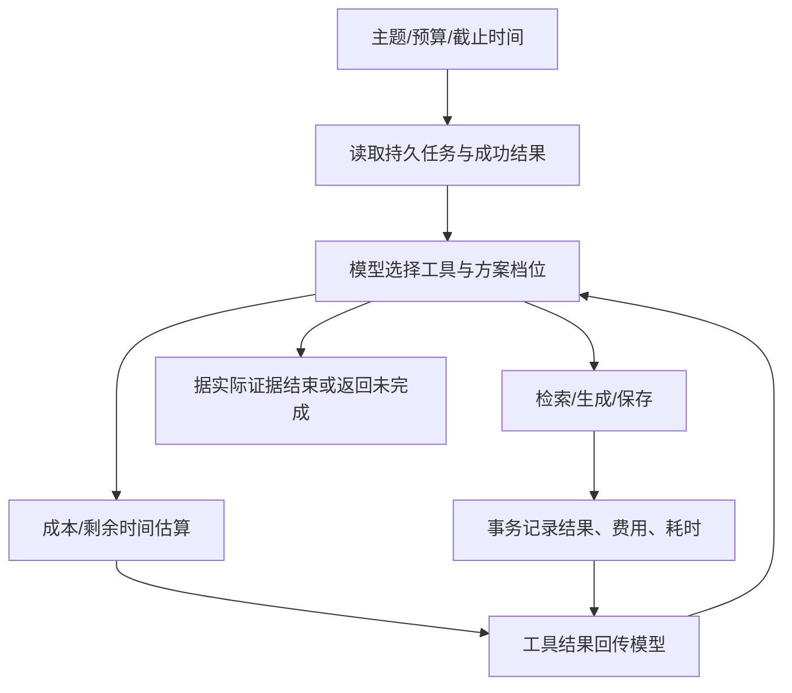

# 02 动态决策与工程方案

## 有状态模型循环

依赖骨架是检索→生成→保存；每次选择哪个方案、何时重新估算、失败后改方案还是停止，由真实模式中的模型决定。运行器没有把premium超限时自动改为lean，也不会生成假模型决策日志。MockModel是另行标记的确定性观察策略，只验证工程链路。

工具为inspect_run、estimate_plan、search_assets、generate_script、save_plan、finish。模型只能传plan_id，不能传新预算、截止时间、费用或成功状态。只有业务工具提交结果，才能改变步骤和账本。finish要求有保存、缺输入、不可行、缺素材或工具失败证据。

## 模型接入

Chat Completions function calling每轮恰好一个动作，回传实际tool观察及原调用ID。DeepSeek非思考模式用required，其它模式auto；零/多调用或不合规短依据会拒绝执行并明确反馈模型，每次纠正计入步数。HTTP错误/响应畸形明确中止，不切换Mock。响应上限1MiB、调用超时45秒、默认模型步骤上限40，范围1–100。必要思考字段仅在内存回传，不写入Trace。

接口参考：[DeepSeek Chat Completions](https://api-docs.deepseek.com/api/create-chat-completion/)。模型ID由配置提供，本机入口使用已核对的deepseek-flash；实际模型版本随服务商别名变化，不保证固定权重。

## 剩余成本与时间

估算的公式为：`预计最终费用 = 已提交尝试费用合计 + 尚未成功步骤的候选方案费用`。预计完成时间等于持久起点＋已耗业务分钟＋未完成步骤耗时。成功步骤排除在剩余工作之外，失败历史不消失。

例：premium素材成功花4，脚本失败花1，改用lean且复用素材，剩余脚本5和保存1，预计/最终总费用11。lean基础报价8仍可显示，但不能用它替换累计费用。预算为整数模拟单位，避免浮点误差；0是有效预算。

每次收费尝试使revision递增；下一业务步骤必须有同档位、同revision的可行估算。工具执行在写事务中重新读取状态、检查依赖和预算/时间上限，防止模型使用过期估算或并发超扣。估算免费，不推进业务时钟。

## 持久化、幂等与续跑

SQLite保存runs（请求摘要和状态）、attempts（每次结果/费用/耗时）、plans（每run唯一方案）。状态中的steps表示最新结果，失败历史则在attempts永久保留。步骤成功后再调用时返回REUSED，新增费用0；生成脚本和保存不能悄悄变更已成功方案档位，检索结果可跨档位复用。

使用BEGIN IMMEDIATE将依赖检查、账本写入、输出和状态一并提交。SQL写入异常回滚，返回STORAGE_FAILURE且本次费用0；测试使用触发器实际阻断保存插入，证明方案、费用与步骤同时回滚。并发相同检索只有一次执行收费。

生成失败后，素材和失败账目保留；同输入/同数据库的未来调用可从持久状态继续。保存失败后素材和脚本保留，只补保存。重复完成的请求读取已有方案并结束，费用不增加。输入改动必须新request_id；数据/价格表改动必须新数据库，防止重新解释旧账本。

## 实现选择与复用

Python 3.11标准库原生实现，无Agent框架。通用HTTP工具调用适配和Windows密码框来自同会话前一项目的可复用代码，已复制调整为本仓库内模块，不跨目录导入。新项目独立实现预算估算、模拟时钟、步骤依赖、事务账本、续跑和方案保存。

没有使用多Agent或生产Runtime。CLI用户输入视为可信请求；素材文本按不可信资料处理。没有任意代码执行、预算修改或发布工具。
